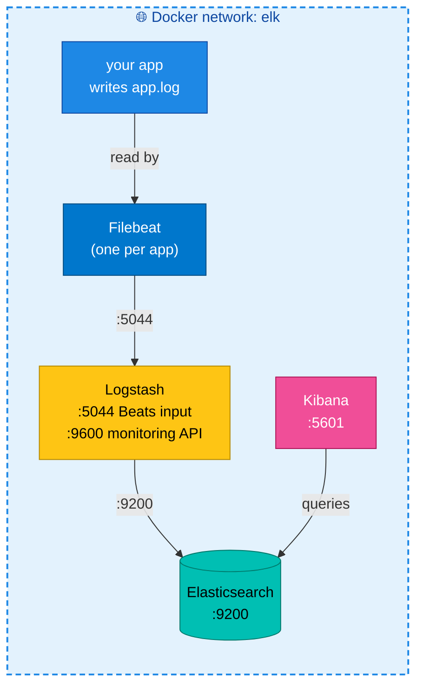

# Architecture & Data Flow

> This page follows a single log line on its journey from your app all the way to your screen,
> and explains the one acronym you must know: **ETL**.

---

## The big picture

```mermaid
flowchart LR
    subgraph App["Your Application"]
        A1["app.py writes a log line"]
        A2["app.log file"]
        A1 --> A2
    end

    subgraph Beat["Filebeat (a Beat)"]
        B1["tails the log file<br/>and ships new lines"]
    end

    subgraph LS["Logstash"]
        L1["INPUT<br/>receive on :5044"]
        L2["FILTER<br/>parse + clean + enrich"]
        L3["OUTPUT<br/>send to Elasticsearch"]
        L1 --> L2 --> L3
    end

    subgraph ES["Elasticsearch :9200"]
        E1["store as JSON document"]
        E2["build inverted index"]
        E1 --> E2
    end

    subgraph KB["Kibana :5601"]
        K1["you search + chart<br/>in the browser"]
    end

    A2 --> B1 --> L1
    L3 --> E1
    E2 --> K1
```



Read it left to right: **App → Filebeat → Logstash → Elasticsearch → Kibana.** Each box does
exactly one job, and the data only ever flows one direction.

---

## Following one log line, step by step

1. **Your app writes a log.** Your Flask app handles a request and appends one line to
   `app.log`. It does *not* know anything about ELK — it just writes to a file. (This is good:
   logging shouldn't slow your app down or depend on the log system being up.)

2. **Filebeat ships it.** Filebeat is a tiny agent watching that file. The instant a new line
   appears, it reads it and forwards it over the network to Logstash (port `5044`). Think of it
   as a courier permanently parked next to your log file. (More in [03-beats.md](03-beats.md).)

3. **Logstash transforms it (the ETL step).** Logstash receives the raw line, **parses** it into
   structured fields, maybe **adds** info (like turning an IP into a country), then sends the
   clean JSON onward. See the ETL section below.

4. **Elasticsearch stores + indexes it.** The clean JSON document is saved into an *index* and
   added to the inverted index, so it is immediately searchable.

5. **You look at it in Kibana.** You open Kibana in your browser, type a search, and see the log
   — plus you can chart "errors per minute" or build a dashboard.

---

## ETL — Extract, Transform, Load

**ETL** is a classic data-engineering term. Logstash is essentially a small ETL engine for logs:

| Letter | Stage | What Logstash does | Logstash config block |
|--------|-------|--------------------|-----------------------|
| **E** | **Extract** | Pull the raw log in from a source (Filebeat, a file, a queue) | `input { ... }` |
| **T** | **Transform** | Parse the messy text into fields, drop junk, add new fields | `filter { ... }` |
| **L** | **Load** | Write the finished document into the destination (Elasticsearch) | `output { ... }` |

**Real-world analogy — making orange juice:**
- **Extract** = pick the oranges (get the raw logs).
- **Transform** = wash, peel, squeeze, remove seeds (parse and clean the data).
- **Load** = pour into bottles on the shelf (store in Elasticsearch, ready to use).

### What "Transform" actually looks like

A raw web-server log line is just text:

```
192.168.1.100 - - [10/Oct/2024:14:32:01 +0000] "GET /checkout HTTP/1.1" 500 1024
```

That's useless for searching — it's one big string. Logstash's `filter` (using a pattern
matcher called **grok**) turns it into structured fields:

```json
{
  "client_ip": "192.168.1.100",
  "timestamp": "10/Oct/2024:14:32:01 +0000",
  "method":   "GET",
  "url":      "/checkout",
  "status":   500,
  "bytes":    1024
}
```

Now you can ask real questions: *"how many `status: 500` responses on `/checkout`?"* — which is
impossible when it's just a line of text. **That transform is the whole reason Logstash exists.**

> **Do you always need Logstash?** No. If your app already writes **clean JSON logs**, Filebeat
> can send them straight to Elasticsearch and skip Logstash entirely. You only need Logstash
> when logs are messy and need parsing/enriching. Our two projects show both paths:
> Project 1 skips Logstash (JSON logs); Project 2 uses Logstash (raw access logs that need grok).

---

## Where each piece runs (in this lab)



All five containers join one Docker network called `elk` so they can reach each other by name
(`elasticsearch`, `logstash`, `kibana`). The networking details are in
[05-elk-with-applications.md](05-elk-with-applications.md).

---

## Key takeaways

- ✅ Logs flow one way: **App → Filebeat → Logstash → Elasticsearch → Kibana**
- ✅ **ETL** = **E**xtract (input) → **T**ransform (filter) → **L**oad (output) — Logstash's three jobs
- ✅ The **Transform** step turns messy text into searchable fields (this is why Logstash exists)
- ✅ Logstash is **optional** — clean JSON logs can go Filebeat → Elasticsearch directly

---

[← What is ELK?](01-what-is-elk.md) | [Next: Beats →](03-beats.md)
