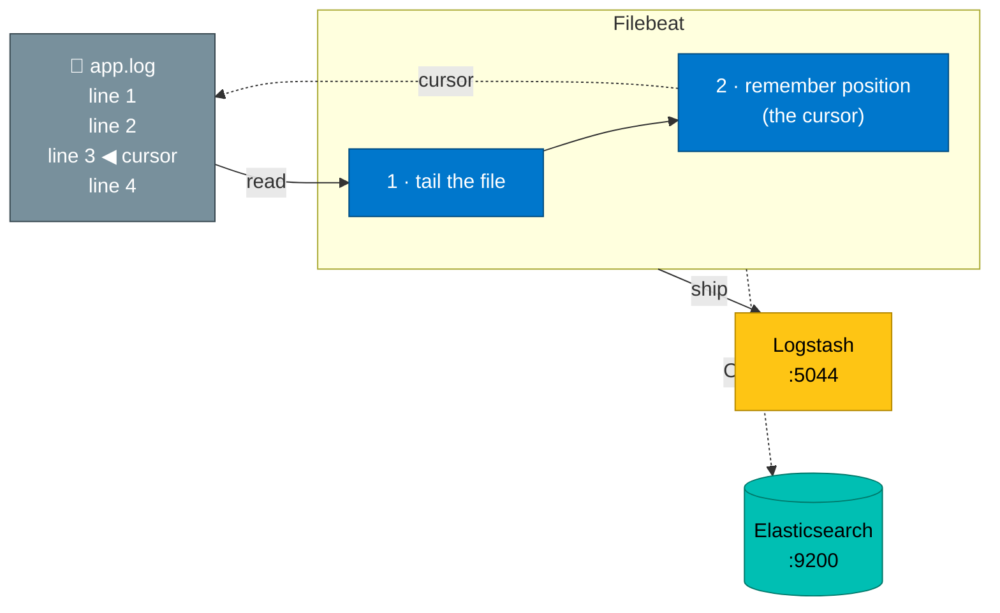
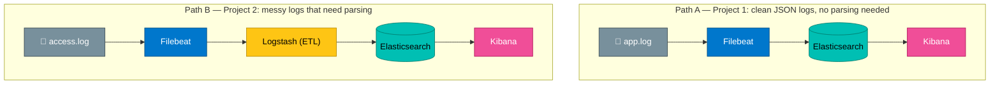

# Beats — the log shippers

> **Beats** are tiny, lightweight agents that you install *next to* your application. Their only
> job is to **collect data and ship it** into the ELK Stack. The one you'll use for logs is
> **Filebeat**.

---

## Why do we even need Beats?

Elasticsearch and Logstash are heavy Java programs. You would **not** want to run them on every
single application server — they'd eat all your memory.

Instead you run a **Beat**: a small program (written in Go, uses very little RAM/CPU) whose only
job is to watch a log file and forward new lines. It's the courier of the ELK world.

**Real-world analogy:** Logstash and Elasticsearch are the big central post-office and warehouse.
You don't put a warehouse in everyone's house. Instead, each house gets a small **mailbox with a
courier** (Filebeat) who picks up outgoing mail and drives it to the post office. Cheap, light,
everywhere.

---

## The Beats family

Beats is a *family* of shippers — each specializes in one kind of data:

| Beat | Ships… | Real-world use |
|------|--------|----------------|
| **Filebeat** | **Log files** (text logs) | The main one — ship `app.log`, `access.log`, etc. |
| **Metricbeat** | System & service **metrics** (CPU, memory) | Like a mini-Prometheus for ELK |
| **Packetbeat** | **Network** traffic data | Spot slow database queries on the wire |
| **Heartbeat** | **Uptime** checks (is this URL up?) | Like Project 5 in this repo, but for ELK |
| **Winlogbeat** | **Windows Event Logs** | Ship Windows security/app events |
| **Auditbeat** | Linux **audit** / file-integrity data | Security monitoring |

> **You only need Filebeat for this lab.** The others are listed so you know they exist — they
> all work the same way: a small agent that ships one type of data into ELK.

---

## How Filebeat works



1. **Tail the file.** Filebeat watches the log file and reads new lines as they're written
   (just like the `tail -f` command).
2. **Remember its position.** It keeps a bookmark (a "registry") of how far it has read, so if it
   restarts it doesn't re-send old lines or miss new ones. This is what makes it reliable.
3. **Ship the lines.** It sends each line to its configured destination — either Logstash (if the
   logs need parsing) or straight to Elasticsearch (if they're already clean JSON).
4. **Back-pressure.** If the destination is busy, Filebeat slows down and retries instead of
   dropping logs. You don't lose data during a spike.

---

## The two shipping paths (you'll do both)



- **Use Path A when** your app already logs clean JSON. Simpler, fewer moving parts.
- **Use Path B when** logs are raw text and need to be parsed into fields (the Logstash ETL step).

> The "L" in ELK is genuinely optional. Many real setups are just **Beats + Elasticsearch +
> Kibana** (sometimes called the "Elastic Stack" rather than "ELK") and only add Logstash when
> they have parsing or enrichment to do.

---

## Filebeat config in one breath

Filebeat is configured by one small YAML file, `filebeat.yml`. The essentials:

```yaml
filebeat.inputs:
  - type: filestream         # watch a file
    paths:
      - /var/log/app/*.log   # which file(s) to watch

output.elasticsearch:        # where to send (Path A)
  hosts: ["http://elasticsearch:9200"]
# --- OR ---
output.logstash:             # where to send (Path B)
  hosts: ["logstash:5044"]
```

A full, line-by-line breakdown is in [04-config-breakdown.md](04-config-breakdown.md), and you'll
use real versions of this file in both projects.

---

## Key takeaways

- ✅ **Beats** are tiny, lightweight shippers you run next to your app (low memory, written in Go)
- ✅ **Filebeat** is the Beat for log files — it tails files and ships new lines reliably
- ✅ It **remembers its position**, so it never loses or duplicates logs across restarts
- ✅ Filebeat can ship to **Logstash** (when logs need parsing) or **Elasticsearch** (when clean)
- ✅ Other Beats exist (Metricbeat, Heartbeat, …) but all follow the same "small agent" pattern

---

[← Architecture](02-architecture.md) | [Next: Config file breakdown →](04-config-breakdown.md)
