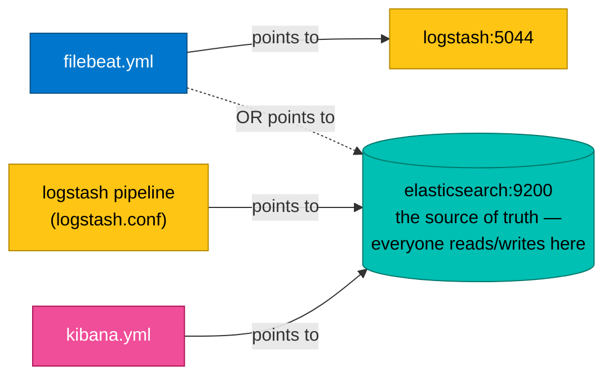

# Config File Breakdown

> Each ELK component is steered by one config file. This page lists **where each file lives**
> and breaks down **every important line** in plain English — so the files in `02-setup/` and the
> projects aren't a black box.

There are four config files to know:

| Component | Config file | Format | What it controls |
|-----------|-------------|--------|------------------|
| Elasticsearch | `elasticsearch.yml` | YAML | The database/search engine |
| Logstash | `logstash.yml` + a **pipeline** `.conf` | YAML + custom | Settings + the ETL pipeline |
| Kibana | `kibana.yml` | YAML | The web UI |
| Filebeat | `filebeat.yml` | YAML | The log shipper |

---

## Default config file paths

Knowing *where* these live matters when you need to edit them. The path differs by install method:

| Component | Inside the Docker image | Native install (Linux, for reference) |
|-----------|-------------------------|----------------------------------------|
| Elasticsearch | `/usr/share/elasticsearch/config/elasticsearch.yml` | `/etc/elasticsearch/elasticsearch.yml` |
| Logstash settings | `/usr/share/logstash/config/logstash.yml` | `/etc/logstash/logstash.yml` |
| Logstash pipeline | `/usr/share/logstash/pipeline/*.conf` | `/etc/logstash/conf.d/*.conf` |
| Kibana | `/usr/share/kibana/config/kibana.yml` | `/etc/kibana/kibana.yml` |
| Filebeat | `/usr/share/filebeat/filebeat.yml` | `/etc/filebeat/filebeat.yml` |

> **In this lab we use Docker**, so we keep our config files on the host (in `02-setup/config/`
> and each project folder) and **bind-mount** them into the container at the paths above. That
> way you edit a normal file on your machine and the container picks it up.

---

## 1. `elasticsearch.yml` — the database

For learning, we set most of Elasticsearch's options as **environment variables** in
`docker-compose.yml` rather than a file (Docker turns them into config automatically). The ones
that matter:

```yaml
environment:
  - discovery.type=single-node        # run as ONE node, not a cluster (perfect for a laptop)
  - xpack.security.enabled=false      # turn OFF passwords/TLS — LOCAL LEARNING ONLY
  - ES_JAVA_OPTS=-Xms512m -Xmx512m    # give the JVM 512MB of heap memory (min and max)
  - cluster.name=elk-lab              # a friendly name for this cluster
```

| Setting | Plain-English meaning | Why it matters |
|---------|----------------------|----------------|
| `discovery.type=single-node` | "Don't look for other servers to cluster with." | Stops Elasticsearch from waiting forever for teammates that don't exist on your laptop |
| `xpack.security.enabled=false` | "No login, no certificates." | Removes all auth friction for learning. **In production this would be `true`** with a password |
| `ES_JAVA_OPTS=-Xms512m -Xmx512m` | "Java may use 512MB of RAM." | Elasticsearch runs on the JVM and reserves memory up front. Too low = crashes; this is fine for a lab. Set min (`-Xms`) and max (`-Xmx`) equal to avoid resize pauses |
| `cluster.name` | A label for the cluster | Cosmetic here, but real clusters use it to identify themselves |

**Data location:** Elasticsearch writes its actual indexes to `/usr/share/elasticsearch/data`
inside the container. We mount a Docker **named volume** (`esdata`) there so your logs survive a
container restart — same idea as `promdata` for Prometheus elsewhere in this repo.

---

## 2. Logstash — two files

Logstash needs **two** kinds of config: global settings, and the pipeline (the actual ETL logic).

### a) `logstash.yml` — global settings

```yaml
http.host: "0.0.0.0"                                    # expose the monitoring API (port 9600)
xpack.monitoring.enabled: false                        # don't ship Logstash's own stats anywhere
pipeline.ecs_compatibility: disabled                   # use flat field names (clientip, verb, response...)
```

| Setting | Meaning |
|---------|---------|
| `http.host: 0.0.0.0` | Listen on all network interfaces so the `:9600` health API is reachable |
| `xpack.monitoring.enabled: false` | Keep it simple — don't self-monitor in this lab |
| `pipeline.ecs_compatibility: disabled` | Make grok use classic flat field names (`clientip`, `verb`, `response`…). Logstash 8.x otherwise uses ECS names like `http.response.status_code`, which wouldn't match our pipeline/docs |

### b) The pipeline `.conf` — the ETL itself (the important one)

This is the heart of Logstash. It has the **three ETL blocks** from
[02-architecture.md](02-architecture.md):

```ruby
input {                                   # ---- EXTRACT: where logs come IN ----
  beats {
    port => 5044                          # listen for Filebeat on port 5044
  }
}

filter {                                  # ---- TRANSFORM: clean + parse ----
  grok {                                  # grok = pattern matcher for text
    match => { "message" => "%{COMBINEDAPACHELOG}" }   # parse an Apache access-log line
  }
  date {
    match => [ "timestamp", "dd/MMM/yyyy:HH:mm:ss Z" ] # turn the log's time into a real date
  }
  mutate {
    convert => { "response" => "integer" }             # make the status code a number, not text
  }
}
# (The real file also strips Filebeat's own metadata fields before grok — see the comments in
#  elk/02-setup/config/pipeline/logstash.conf for why.)

output {                                  # ---- LOAD: where logs go OUT ----
  elasticsearch {
    hosts => ["http://elasticsearch:9200"]
    index => "web-access-%{+YYYY.MM.dd}"  # one index per day, e.g. web-access-2024.10.10
  }
}
```

| Block | ETL stage | What it does here |
|-------|-----------|-------------------|
| `input { beats {...} }` | **Extract** | Open port 5044 and accept logs from Filebeat |
| `filter { grok {...} }` | **Transform** | Match the raw line against a pattern and pull out fields (`client_ip`, `url`, `status`…) |
| `filter { date {...} }` | **Transform** | Use the timestamp *from the log* as the event time (not "now") |
| `filter { mutate {...} }` | **Transform** | Fix data types (text → number) so you can do math/ranges |
| `output { elasticsearch {...} }` | **Load** | Send the finished JSON to Elasticsearch, into a daily index |

> **What is grok?** Grok is Logstash's way of parsing text with **named patterns**.
> `%{COMBINEDAPACHELOG}` is a built-in pattern that already knows the shape of a standard web
> access log, so one word unpacks the whole line into fields. You'll see this in Project 2.

> **Why a daily index** (`web-access-%{+YYYY.MM.dd}`)? Rolling indexes by day makes it trivial to
> delete old logs ("drop everything older than 30 days" = delete old indexes) and keeps each
> index a manageable size.

---

## 3. `kibana.yml` — the web UI

Kibana barely needs configuring. It only needs to know where Elasticsearch is:

```yaml
elasticsearch.hosts: ["http://elasticsearch:9200"]   # where to read data from
server.host: "0.0.0.0"                                # listen on all interfaces so you can open :5601
```

| Setting | Meaning | Why it matters |
|---------|---------|----------------|
| `elasticsearch.hosts` | The address of Elasticsearch | Kibana is just a front-end; it reads *everything* from here |
| `server.host: 0.0.0.0` | Accept browser connections from outside the container | Without it you couldn't reach Kibana from your laptop |

> Notice the address is `http://elasticsearch:9200`, **not** `localhost`. Inside Docker,
> `elasticsearch` is the container's name on the `elk` network. (Same rule as
> `http://prometheus:9090` in the Grafana part of this repo.) See
> [05-elk-with-applications.md](05-elk-with-applications.md).

---

## 4. `filebeat.yml` — the log shipper

This tells Filebeat **what to read** and **where to send it**:

```yaml
filebeat.inputs:
  - type: filestream            # watch a continuously-growing file
    id: app-logs                # a unique id for this input
    paths:
      - /var/log/app/*.log      # the file(s) to tail
    parsers:
      - ndjson:                 # tell Filebeat each line is already JSON (Project 1 only)
          target: ""            # put the parsed JSON fields at the top level

output.elasticsearch:           # Path A — straight to Elasticsearch (Project 1)
  hosts: ["http://elasticsearch:9200"]
  index: "flask-logs-%{+yyyy.MM.dd}"

setup.template.name: "flask-logs"   # name the index template
setup.template.pattern: "flask-logs-*"
setup.ilm.enabled: false            # disable index lifecycle mgmt so our custom index name works
```

| Setting | Meaning | Why it matters |
|---------|---------|----------------|
| `type: filestream` | The modern input for tailing files | Reads new lines as they're written, remembers position |
| `paths` | Which files to watch | A glob like `*.log` catches rotated files too |
| `parsers: ndjson` | "Each line is JSON, decode it" | Skips Logstash — fields are already structured |
| `output.elasticsearch` | Send directly to ES (Path A) | Use when logs are clean; **swap for `output.logstash` for Path B** |
| `index` | The destination index name | Daily index, like Logstash's |
| `setup.ilm.enabled: false` | Turn off automatic index-lifecycle naming | Lets our custom `index:` name actually take effect |

For **Path B** (Project 2), the output section instead points at Logstash:

```yaml
output.logstash:
  hosts: ["logstash:5044"]      # send raw lines to Logstash for parsing first
```

> **Filebeat permissions note:** the official Filebeat image requires `filebeat.yml` to be owned
> by root and **not** world-writable, or it refuses to start with a "config file must be owned by
> the user running the process" error. In Docker we handle this by running Filebeat with
> `--strict.perms=false` (shown in the project compose files) so the bind-mounted file is accepted.

---

## How they all reference each other



Every arrow uses a **container name** (`elasticsearch`, `logstash`) instead of `localhost`,
because they all live on the same Docker `elk` network.

---

## Key takeaways

- ✅ Four config files: `elasticsearch.yml`, `logstash.yml` + pipeline `.conf`, `kibana.yml`, `filebeat.yml`
- ✅ Elasticsearch options are passed as **env vars** in Docker (single-node, security off, JVM heap)
- ✅ The Logstash **pipeline** `.conf` is the real ETL: `input` (extract) → `filter` (transform) → `output` (load)
- ✅ **grok** parses messy text into fields; the **date** filter sets the real event time
- ✅ Kibana and Logstash both point at Elasticsearch by **container name**, never `localhost`
- ✅ Filebeat chooses the path: `output.elasticsearch` (skip Logstash) or `output.logstash` (parse first)

---

[← Beats](03-beats.md) | [Next: ELK with your applications →](05-elk-with-applications.md)
