# Connecting Web Access Log Analyzer to ELK

Follow these steps in order. Each has a verify step. This is the **full pipeline** — note the extra
Logstash hop compared to Project 1.

```
web-access-log-analyzer → access.log → Filebeat → Logstash (grok) → Elasticsearch → Kibana
```

---

## Before you start

The ELK stack must be up **including Logstash** (this project depends on it for parsing):

```bash
cd ../../02-setup
docker compose up -d
docker compose ps          # elasticsearch "healthy"; logstash + kibana "running"
```

Confirm Logstash is accepting Beats connections:
```bash
curl -s http://localhost:9600 | head -c 80
```
Expected: JSON starting with `{"host":...`. If it refuses, Logstash is still booting — wait ~30s.

---

## Step 1 — Start the app and Filebeat

From `elk/projects/02-web-access-log-analyzer/`:

```bash
docker compose up -d --build
```

**Expected output:**
```
[+] Running 2/2
 ✔ Container web-access-log-analyzer  Started
 ✔ Container filebeat-web-access      Started
```

The app starts generating traffic immediately (a background thread). **Verify:**
```bash
curl http://localhost:8092/stats
```
Expected (the count climbs as you re-run it):
```json
{"lines_written": 12, "log_file": "/var/log/web/access.log"}
```

**See the raw lines being written:**
```bash
docker exec web-access-log-analyzer tail -n 3 /var/log/web/access.log
```
You'll see raw text lines like `192.168.1.42 - - [.../...] "GET /checkout HTTP/1.1" 500 1024 ...`.

---

## Step 2 — Watch Logstash parse the lines (the ETL in action)

This is the fun part. The Logstash pipeline prints every parsed document to its console:

```bash
docker logs --tail 20 logstash
```

You should see structured output where the **raw line has been broken into fields**:

```ruby
{
      "clientip" => "192.168.1.42",
          "verb" => "GET",
       "request" => "/checkout",
      "response" => 500,
         "bytes" => 1024,
         "agent" => "\"Mozilla/5.0 (X11; Linux x86_64)\"",
    "@timestamp" => 2024-10-10T14:32:01.000Z
}
```

> See `response => 500` as a **number** (not `"500"` text)? That's the `mutate { convert }` step in
> the pipeline doing its job. That's why you'll be able to do ranges like `response >= 500` later.

> **Seeing `_grokparsefailure` tags?** A line didn't match the pattern. With this generator that
> shouldn't happen — but in the real world it's how you spot logs your grok pattern doesn't handle.

---

## Step 3 — Confirm the parsed docs reached Elasticsearch

```bash
curl -s "http://localhost:9200/_cat/indices/web-access-*?v"
```

Expected — a `web-access-YYYY.MM.dd` index with a growing `docs.count`:
```
health status index                  ... docs.count store.size
yellow open   web-access-2024.10.10  ...         34     60kb
```

Peek at one stored, fully-parsed document:
```bash
curl -s "http://localhost:9200/web-access-*/_search?size=1&pretty"
```
Inside `_source` you'll see the separate fields (`clientip`, `verb`, `response`…) — proof that the
once-unstructured line is now structured data.

---

## Step 4 — View in Kibana

1. Open **http://localhost:5601** → **☰ Menu → Discover**.
2. **Create data view:**
   - **Name:** `web-access`
   - **Index pattern:** `web-access-*`
   - **Timestamp field:** `@timestamp`
   - **Save data view to Kibana**.
3. Set the time picker (top right) to **Last 15 minutes**.

You'll see the access logs as a searchable table with a traffic-over-time chart on top. 🎉

---

## Step 5 — Explore the parsed fields (KQL)

In the Discover search bar try:

| Search | Shows |
|--------|-------|
| `response >= 500` | Server errors (only possible because `response` is a number now) |
| `response: 404` | Not-found requests |
| `request: "/checkout"` | All traffic to checkout |
| `verb: "POST"` | Only POST requests |
| `agent: *Googlebot*` | Bot traffic |
| `response >= 400 and request: "/checkout"` | Failed checkouts |

Click the `response` field on the left → **Visualize** to chart status codes over time. More
examples in [`../../03-queries/`](../../03-queries/README.md).

---

## How it works (recap)

```mermaid
flowchart LR
    A["1 · app.py<br/>writes a RAW text line"]:::app
    B["2 · Filebeat<br/>tails the file"]:::beat
    subgraph LS["3 · Logstash"]
        direction TB
        E["EXTRACT<br/>beats input"]:::ls
        T["TRANSFORM<br/>grok → fields, date, type-convert"]:::ls
        L["LOAD<br/>sends JSON to elasticsearch:9200"]:::ls
        E --> T --> L
    end
    ES[("Elasticsearch<br/>index web-access-YYYY.MM.dd")]:::es
    K["4 · Kibana<br/>you search and chart<br/>structured fields"]:::kb
    A -->|"/var/log/web/access.log"| B
    B -->|"ships raw lines to<br/>logstash:5044"| E
    L --> ES
    ES -->|"reads the index"| K
    classDef app fill:#1E88E5,stroke:#0D47A1,color:#fff
    classDef beat fill:#0077CC,stroke:#004C80,color:#fff
    classDef es fill:#00BFB3,stroke:#00796B,color:#000
    classDef kb fill:#F04E98,stroke:#AD1457,color:#fff
    classDef ls fill:#FEC514,stroke:#B58900,color:#000
```



The difference from Project 1 is **Step 3**: Logstash sits in the middle and turns text into fields.

---

## Clean up

See **[CLEANUP.md](CLEANUP.md)**. Quick version:

```bash
docker compose down -v
```

The ELK stack in `02-setup/` keeps running.
