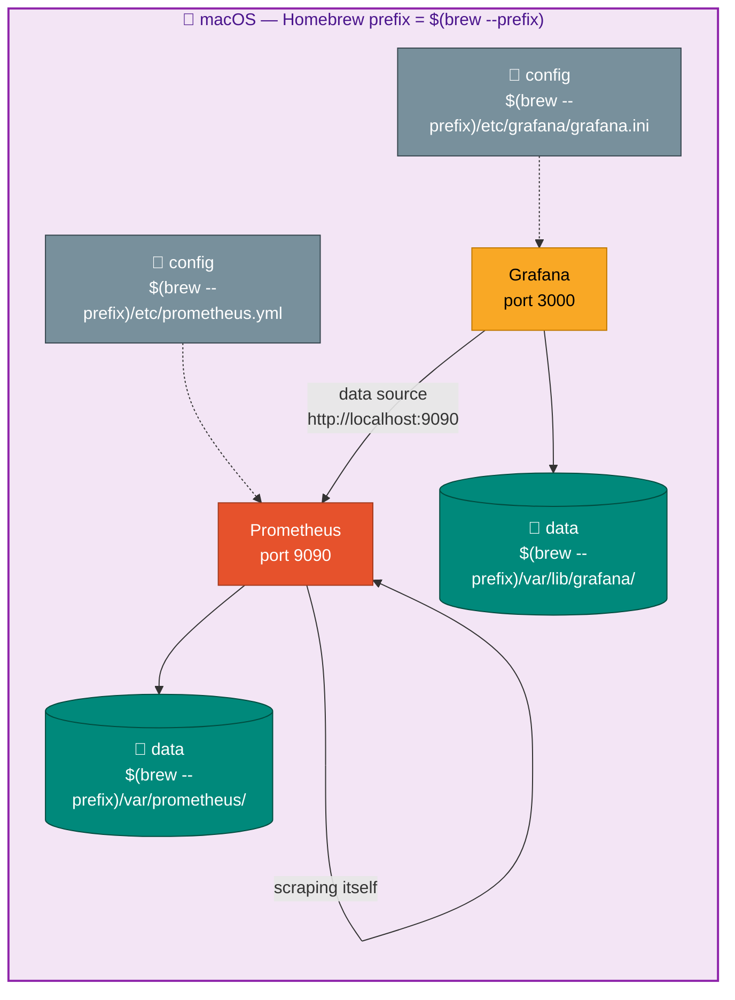

# Connect Prometheus to Grafana (macOS)

At this point you have Prometheus running on port 9090 and Grafana on port 3000. This step
adds Prometheus as a data source inside Grafana so you can run queries and build dashboards.

The wiring itself is identical on every OS — only the file paths differ. The Grafana data
source still points at `http://localhost:9090`, because both run natively on the same Mac.

---

## Prerequisites

- Prometheus is running: `curl -s http://localhost:9090/-/healthy` returns `Prometheus Server is Healthy.`
- Grafana is running: `curl -s http://localhost:3000/api/health` returns `{"database": "ok", ...}`

---

## Step 1 — Add Prometheus as a data source

**Via the Grafana UI:**

1. Open **http://localhost:3000** and log in (`admin` / `admin`)
2. Click the hamburger menu (☰) → **Connections** → **Data sources**
3. Click **Add data source** → select **Prometheus**
4. Set the URL to:
   ```
   http://localhost:9090
   ```
5. Leave all other settings at their defaults
6. Click **Save & test**

Expected result: a green banner saying **"Successfully queried the Prometheus API."**

**Via the API (alternative — no browser needed):**

```bash
curl -s -u admin:admin \
  -X POST http://localhost:3000/api/datasources \
  -H "Content-Type: application/json" \
  -d '{
    "name": "Prometheus",
    "type": "prometheus",
    "url": "http://localhost:9090",
    "access": "proxy",
    "isDefault": true
  }' | python3 -m json.tool
```

Expected output includes:
```json
{
    "message": "Datasource added",
    "name": "Prometheus"
}
```

---

## Step 2 — Verify with a test query

1. In Grafana, hamburger menu → **Explore**
2. Make sure the data source dropdown shows **Prometheus**
3. In the query box, type `up` and press Shift+Enter

You should see a result with value `1` for the `prometheus` job. This confirms Grafana can
query Prometheus.

---

## Step 3 — Import the macOS project dashboard (optional)

The `projects-native/06-mac-system-monitor/` dashboard is a standalone JSON file:

1. Hamburger menu → **Dashboards** → **New** → **Import**
2. Click **Upload dashboard JSON file**
3. Select `projects-native/06-mac-system-monitor/dashboards/mac-system-monitor.json`
4. Select **Prometheus** as the data source → **Import**

Panels will show "No data" until the project is running and Prometheus is scraping it. Follow
`projects-native/06-mac-system-monitor/CONNECT.md` to complete the wiring.

---

## Step 4 — Verify the complete chain

```bash
curl -s 'http://localhost:9090/api/v1/query?query=up' | python3 -c "
import sys, json
d = json.load(sys.stdin)
for r in d['data']['result']:
    print(r['metric']['job'], '→', r['value'][1])
"
```

Expected output:
```
prometheus → 1
```

Once you start Project 6 and uncomment its scrape job, the list grows:
```
prometheus → 1
mac-system-monitor → 1
```

---

## Prometheus config location reminder

For the macOS native setup, the Prometheus config is at `$(brew --prefix)/etc/prometheus.yml`.
To add a new scrape target, edit that file and reload:

```bash
nano "$(brew --prefix)/etc/prometheus.yml"
# ... uncomment the project block ...

# manual run (Step 6b in the install guide):
curl -X POST http://localhost:9090/-/reload
# brew services:
brew services restart prometheus
```

---

## Summary — what you have now



Next: start `projects-native/06-mac-system-monitor/` and follow its `CONNECT.md` to wire it in.
