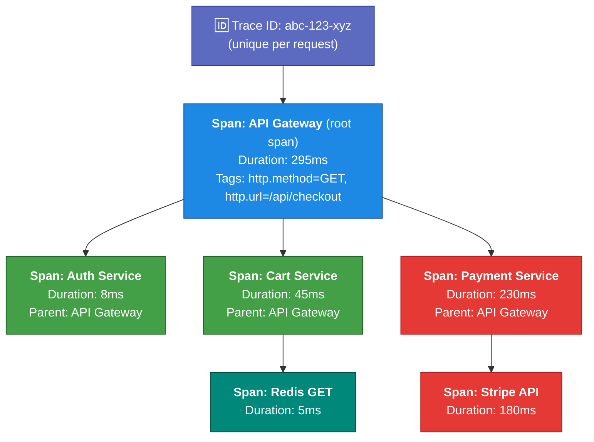

# Traces

> Traces follow a single request as it travels through your system. Essential for microservices.

---

## What is a Trace?

A trace represents the **complete journey of one request** through all the services it touches.

```mermaid
gantt
    title User Request GET /api/checkout — total 295ms
    dateFormat x
    axisFormat %L ms
    section API Gateway 12ms
    API Gateway                 :active, 0, 12
    Auth service call 8ms ✅     :done, 1, 9
    Rate limiter check 2ms ✅    :done, 9, 11
    section Cart Service 45ms
    Cart Service                :active, 12, 57
    Redis cache lookup 5ms ✅    :done, 14, 19
    section Payment Service 230ms — SLOW!
    Payment Service ← SLOW!     :crit, 57, 287
    Stripe API call 180ms ⚠️     :crit, 59, 239
    Database write 45ms ✅       :done, 240, 285
    section Email Service 8ms
    Email Service               :active, 287, 295
    SendGrid API 6ms ✅          :done, 288, 294
```



Without traces, you'd see "checkout is slow" but not know it's the Stripe API call causing it.

---

## Trace Anatomy



---

## Traces vs Metrics vs Logs

| | Metrics | Logs | Traces |
|--|---------|------|--------|
| Question | What? | What happened? | Why? (request path) |
| Data type | Numbers over time | Text events | Nested spans |
| Storage cost | Low | High | Medium |
| Sampling | 100% | Often sampled | Usually sampled |
| Best for | Alerting, trending | Error details | Latency debugging |

---

## OpenTelemetry: The Standard

OpenTelemetry provides standardized SDKs for instrumenting applications to produce traces (and metrics and logs) in a vendor-neutral way.

```python
# Python with OpenTelemetry
from opentelemetry import trace
from opentelemetry.instrumentation.flask import FlaskInstrumentor

FlaskInstrumentor().instrument()  # Auto-instruments all Flask routes

tracer = trace.get_tracer(__name__)

def process_payment(amount):
    with tracer.start_as_current_span("process-payment") as span:
        span.set_attribute("payment.amount", amount)
        result = stripe.charge(amount)
        span.set_attribute("payment.status", result.status)
        return result
```

---

## Traces in the Grafana Stack

- **Grafana Tempo**: Grafana's open-source distributed tracing backend
- **Jaeger**: CNCF distributed tracing (popular alternative)
- **Zipkin**: Twitter-originated tracing

**Connecting metrics to traces (exemplars):** When a histogram data point is high-latency, Grafana can link directly to the trace for that request.

---

## Key Takeaways

- ✅ Traces follow one request through multiple services
- ✅ Each trace has a unique ID; each service call is a "span"
- ✅ Essential for debugging latency in microservices
- ✅ OpenTelemetry is the standard instrumentation framework
- ✅ Prometheus handles metrics; traces need separate backends (Tempo, Jaeger)

---

[← Logs](02-logs.md) | [Next: Events →](04-events.md)
