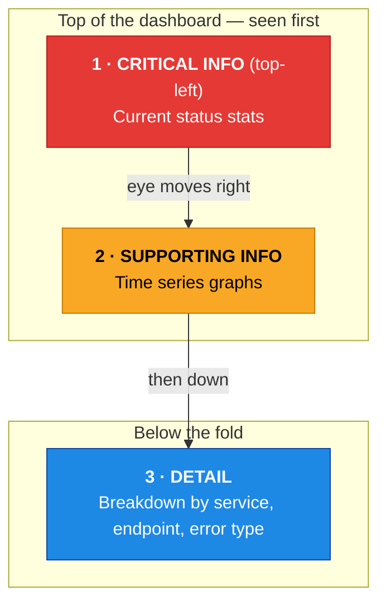

# Dashboards

> A well-designed dashboard answers questions before they're asked.

---

## What is a Monitoring Dashboard?

A dashboard is a **visual display of multiple metrics** organized to give users situational awareness at a glance.

A good dashboard answers: "Is everything okay? If not, what needs my attention right now?"

---

## Dashboard Design Principles

### 1. Single Purpose
Each dashboard should have one clear audience and question it answers.

```
❌ "Everything Dashboard" — 50 panels, nobody knows where to look
✅ "Checkout Service SLO Dashboard" — 8 panels, checkout team knows exactly where to look
```

### 2. Information Hierarchy (F-Pattern)

Users scan dashboards in an F-pattern — top left first:



### 3. Consistent Time Ranges

Panels on the same dashboard should show the same time range. Don't mix "last 5 minutes" with "last 24 hours" on the same dashboard.

### 4. Context Before Details

Show summary first (is the service healthy?), then details (which specific endpoint is slow?).

---

## Dashboard Types

| Type | Purpose | Time Range |
|------|---------|-----------|
| **Operational** | Real-time monitoring, on-call | Last 15-60 minutes |
| **SLO/SLA** | Reliability tracking | Last 7-30 days |
| **Capacity** | Planning infrastructure | Last 90 days |
| **Business** | KPIs and metrics | Last 30 days |
| **Incident** | During an outage | Custom, narrow |

---

## The RED Dashboard (Request, Error, Duration)

The minimum dashboard every service needs:

```
Panel 1: Request Rate (req/s)
  rate(http_requests_total{service="$service"}[5m])

Panel 2: Error Rate (%)  
  rate(http_requests_total{service="$service", status=~"5.."}[5m])
  / rate(http_requests_total{service="$service"}[5m]) * 100

Panel 3: Duration p99 (ms)
  histogram_quantile(0.99,
    rate(http_request_duration_seconds_bucket{service="$service"}[5m])
  ) * 1000
```

---

## Key Takeaways

- ✅ Dashboards should answer a specific question for a specific audience
- ✅ Show summary stats at top, details below
- ✅ Every service should have at minimum: Rate, Error Rate, Duration (RED)
- ✅ Use variables for multi-service dashboards
- ✅ Add deployment annotations to all dashboards

---

[← Events](04-events.md) | [Next: Alerts →](06-alerts.md)
