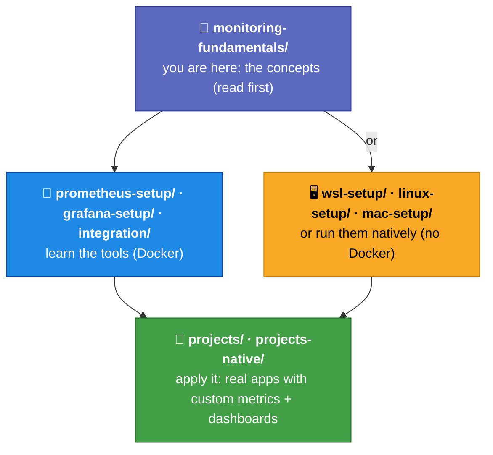

# Monitoring Fundamentals

The **concepts** behind monitoring — the "what" and "why" you should understand *before*
touching Prometheus and Grafana. The rest of this repo is hands-on (install the tools, run
projects, build dashboards); this directory is the reading that makes those exercises click.

These two sections are tool-agnostic: the ideas here apply to any monitoring stack
(Nagios, Datadog, Prometheus, …), not just the tools used elsewhere in this repo.

---

## Sections

| # | Section | Level | Time | What it covers |
|---|---------|-------|------|----------------|
| 1 | [Introduction to Monitoring](01-introduction-to-monitoring/README.md) | Absolute beginner | ~2 h | What monitoring is, its history, monitoring vs observability, the business case, and how DevOps / SRE / Platform teams use it |
| 2 | [Monitoring Fundamentals](02-monitoring-fundamentals/README.md) | Beginner | ~3 h | The building blocks: metrics, logs, traces, events, dashboards, alerts, SLI/SLO/SLA, MTTR/MTTD, and error budgets |

Start with Section 1, then Section 2 — each topic file is short and self-contained.

---

## How this fits with the rest of the repo

Once the terms in Section 2 (metrics, gauges, counters, histograms, SLOs) feel familiar,
the hands-on tracks in the repo root will make a lot more sense. See the top-level
[`README.md`](../README.md) for the full learning order.
